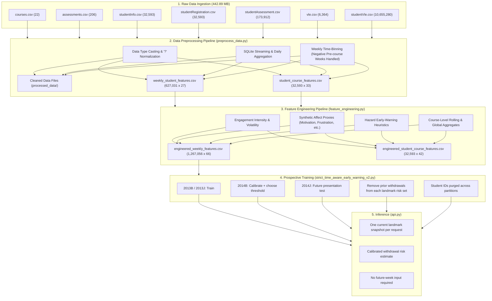

# Unified Persistence Correlator: Comprehensive Technical Documentation
**Project:** Student Dropout Risk, Engagement, and Synthetic Affect Modeling  
**Dataset:** Open University Learning Analytics Dataset (OULAD)  
**System Architecture:** Multi-Level Early Warning System (Longitudinal Weekly Tracking & Retrospective Course-Level Auditing)

---

## 1. Executive Summary & Problem Formulation

The **Unified Persistence Correlator** is an end-to-end predictive learning analytics pipeline designed to identify higher-education students at risk of early withdrawal, disengagement, or course failure. Developed on the Open University Learning Analytics Dataset (OULAD), the project transforms raw demographic, academic assessment, and clickstream Virtual Learning Environment (VLE) data into robust, time-aware predictive models.

### Core Objectives
1. **Longitudinal Risk Tracking (Weekly Horizon):** Continuously evaluate student engagement patterns week-by-week using only historical and contemporary signals up to the observation week, strictly preventing future lookahead data leakage.
2. **Retrospective Course Diagnostic (Student-Course Horizon):** Provide end-of-term post-mortem analysis combining holistic engagement, assessment milestones, and administrative records.
3. **Multi-Faceted Behavioral Proxies:** Compute observable engagement trajectories, simulated affective/wellbeing proxies, and non-linear hazard early-warning indicators to assist academic advisors with actionable intervention insights.

---

## 2. System Architecture & End-to-End Pipeline



---

## 3. Detailed Phase-by-Phase Task Breakdown

### Phase 1: Raw Data Exploration & Schema Analysis (`analyze_raw_data.py`)
- Analyzed 7 primary relational tables totaling 442.89 MB and 10,868,377 total records.
- Identified primary entity identifiers: `id_student`, `code_module` (7 modules: AAA through GGG), and `code_presentation` (4 semesters: 2013B, 2013J, 2014B, 2014J).
- Discovered structural characteristics:
  - Missing values encoded as string `?` in `imd_band` (1,111 records), `date_registration` (45 records), and `date_unregistration` (22,521 records).
  - `studentVle.csv` contains 10,655,280 clickstream interaction records across 6,364 distinct learning resource sites.
  - Target variable `final_result` contains 4 categorical states: Pass (37.93%), Withdrawn (31.16%), Fail (21.64%), and Distinction (9.28%).
  - Pre-course activity exists: dates in `studentVle.csv` and `studentRegistration.csv` range down to `-25` days prior to module launch.

### Phase 2: Data Preprocessing Pipeline (`preprocess_data.py`)
- **Memory-Efficient Streaming:** Handled the massive 432.8 MB `studentVle.csv` via chunked ingestion (200,000 records/chunk) piped into an embedded SQLite database (`vle_daily_aggregation.sqlite`) with upsert logic (`ON CONFLICT DO UPDATE SET total_clicks = total_clicks + excluded.total_clicks`).
- **Pre-Course Week Binning:** Mapped negative study days into negative calendar weeks using floor integer arithmetic `((activity_date - 6) // 7)`.
- **Target Disambiguation:**
  - `target_withdrawn`: 1 if `final_result == 'Withdrawn'`, else 0.
  - `target_completed`: 1 if `final_result in ['Pass', 'Distinction']`, else 0.
  - Enforced strict isolation: outcome labels are strictly reserved for evaluation and never exposed as predictors.
- **Master Dataset Construction:**
  - `weekly_student_features.csv`: 1,267,056 enrollment-calendar-week records across 29 fields, including inactive weeks.
  - `student_course_features.csv`: 32,593 unique student-course registrations across 33 base fields.

### Phase 3: Comprehensive Feature Engineering (`feature_engineering.py`)
- Computed 66 weekly features and 42 course-level features across 5 conceptual domains:
  1. Baseline Demographics and Course Structure
  2. Dynamic Engagement & Clickstream Intensity
  3. Longitudinal Volatility & Trend Derivatives
  4. Heuristic Synthetic Affect & Wellbeing Proxies
  5. Hazard Warning & Risk Flags
- Built an explicit calendar-week panel, including zero-activity weeks, so lag and rolling features use the actual previous calendar weeks.
- Replaced cohort-wide min-max and percentile scaling in the canonical weekly feature and proxy paths with fixed pointwise scales.

### Phase 4: Historical Feature Quality Audit (`feature_selection.py`)

This earlier exploratory workflow is not the canonical future-presentation evaluation described in Section 5.
Its benchmark numbers below came from an earlier random student split and are historical only; they are not estimates of future-presentation performance.
- **Leakage Prevention:** Grouped train/test split (80% train, 20% test) grouped strictly on `id_student`, preventing data leakage from multi-course students.
- **Multicollinearity Elimination:** Evaluated pairwise Pearson correlation matrix on training splits only. Filtered out redundant collinear features ($|r| > 0.95$).
- **Dual-Model Validation:** Trained Random Forest and XGBoost benchmarks to compute Mean Decrease in Impurity (MDI) and Permutation Feature Importance.
- **Selection Output:**
  - 15 selected weekly longitudinal predictors (filtering out 13 collinear/unstable candidates).
  - 20 selected student-course retrospective predictors (filtering out 5 collinear candidates).
- **Benchmark Evaluation:**
  - Weekly Early-Warning Model: Accuracy: **66.45%**, Recall: **73.31%**, ROC-AUC: **0.7649**.
  - Student-Course Model: Accuracy: **85.13%**, Recall: **91.71%**, ROC-AUC: **0.9371**.

### Phase 5: Historical Multi-Component Training (`train_models.py`)

This older row-level pipeline is retained for retrospective experiments and is not used by the current landmark API.
- Designed a unified tri-component architecture:
  1. **Engagement Estimator:** Regresses continuous `engagement_score` to evaluate whether a student is meeting activity benchmarks.
  2. **Synthetic Affect Estimator:** Multi-output regression tracking 6 affect proxies (Motivation, Confidence, Frustration, Stress, Disengagement, Wellbeing).
  3. **Hazard Withdrawal Classifier:** Balanced Random Forest Classifier predicting early student withdrawal probability.

---

## 4. Complete Feature Specification Dictionary

| Feature Name | How It Is Obtained | Why It Is Needed |
| :--- | :--- | :--- |
| **`id_student`** | Extracted from raw student identification records across OULAD tables. | Unique identifier for the individual learner; essential for grouped validation splits to prevent data leakage across module registrations. |
| **`code_module`** | Extracted from module catalogs (`courses.csv`). | Categorical identifier for course domain (AAA through GGG); accounts for domain-specific difficulty, pedagogy, and attrition baselines. |
| **`code_presentation`** | Extracted from module catalogs (`courses.csv`). | Cohort identifier (year + semester: 2013B, 2013J, 2014B, 2014J); captures seasonal differences between February and October intake cohorts. |
| **`week_number`** | Derived from VLE activity date: `activity_date // 7` (or `(activity_date - 6) // 7` for pre-course negative dates). | Temporal anchor for longitudinal modeling; allows models to evaluate risk relative to course milestones (early weeks vs midterm vs final exam prep). |
| **`gender`** | Extracted from `studentInfo.csv` (`M` / `F`). | Demographic baseline predictor; controls for historical subgroup completion disparities. |
| **`region`** | Extracted from `studentInfo.csv` (13 geographic regions across the UK and Ireland). | Identifies geographic location to monitor regional educational disparities and access variations. |
| **`highest_education`** | Extracted from `studentInfo.csv` (5 tiers: No Formal Quals, Lower than A-Level, A-Level, HE Qualification, Post Graduate). | Critical indicator of prior educational preparedness; students entering without formal qualifications experience higher dropout risk. |
| **`imd_band`** | Extracted from `studentInfo.csv` (Index of Multiple Deprivation decile deciles, e.g., 0-10% to 90-100%). | Socioeconomic deprivation proxy; captures structural socioeconomic hurdles impacting academic persistence. |
| **`age_band`** | Extracted from `studentInfo.csv` (0-35, 35-55, 55<=). | Captures life-stage obligations (e.g., adult learners with full-time jobs and parenting commitments having distinct attrition patterns). |
| **`num_of_prev_attempts`** | Extracted from `studentInfo.csv` (integer count 0 to 6). | Direct indicator of prior course struggle; students repeating a course exhibit distinct psychological and academic risk profiles. |
| **`studied_credits`** | Extracted from `studentInfo.csv` (sum of credit points for concurrent modules, 30 to 655). | Academic workload indicator; excessive study load (>120 credits) correlates strongly with burnout, assignment failure, and withdrawal. |
| **`disability`** | Extracted from `studentInfo.csv` (`Y` / `N`). | Accessibility flag; accounts for students who may require targeted institutional accommodation and support. |
| **`date_registration`** | Parsed numeric integer from `studentRegistration.csv` (days relative to module start, e.g., -159 to +167). | Measures enrollment lead time; late registrations (registering close to or after module launch) exhibit significantly higher failure and dropout rates. |
| **`date_unregistration`** | Parsed numeric integer from `studentRegistration.csv` (NaN if active). | Used only to define whether a student is registered and still at risk at a landmark and whether a later withdrawal event occurred; never a predictor. |
| **`has_unregistration_date`** | Binary indicator: `date_unregistration.notna().astype(int)`. | Administrative record indicating whether student formally withdrew; used for retrospective validation. |
| **`module_presentation_length`** | Extracted from `courses.csv` (integer days, 234 to 269 days). | Course duration baseline; normalizes temporal metrics across shorter February sessions vs longer October sessions. |
| **`weekly_total_clicks`** | Aggregated from `studentVle.csv` using SQL sum of `sum_click` grouped by student, module, presentation, and week. | Core primary metric of total learning material interactions per week; drop in volume is the earliest sign of student disengagement. |
| **`weekly_interaction_records`** | Aggregated count of distinct resource access events within the week from `studentVle.csv`. | Breadth of interaction; differentiates between a student clicking one resource 100 times vs navigating 100 different curriculum items. |
| **`weekly_active_days`** | Count of unique days within the week where `sum_click > 0`. | Measure of study habit consistency; studying 5 days/week at 20 clicks/day denotes much healthier persistence than 100 clicks on a single day. |
| **`cumulative_clicks`** | Cumulative sum of `weekly_total_clicks` over observed weeks: `groupby(student_course)['weekly_total_clicks'].cumsum()`. | Total volume of learning capital accumulated to date; students falling behind cohort cumulative medians rarely recover. |
| **`cumulative_interactions`** | Cumulative sum of `weekly_interaction_records` over observed weeks. | Long-term interaction volume reflecting overall platform engagement over time. |
| **`cumulative_active_days`** | Cumulative sum of `weekly_active_days` over observed weeks. | Total historical study days invested in the module; proxies long-term study habit regularity. |
| **`cumulative_active_weeks`** | Running sum of weeks with at least one active day through the current calendar week. | Longitudinal activity duration; denominator for average activity per active week. |
| **`average_clicks_per_active_week`** | Computed as `cumulative_clicks / cumulative_active_weeks`. | Smoothed average weekly effort; buffers single-week anomalies (illness, holidays) to assess true baseline engagement. |
| **`previous_week_clicks`** | Lag-1 shift of `weekly_total_clicks`: `groupby(student_course)['weekly_total_clicks'].shift(1).fillna(0)`. | Temporal context baseline; enables calculating instantaneous velocity and sudden drops in effort. |
| **`click_change_from_previous_week`** | First difference: `weekly_total_clicks - previous_week_clicks`. | Momentum indicator; large negative deltas immediately trigger early-warning intervention protocols. |
| **`days_since_registration`** | Temporal elapsed metric: `week_number * 7 - date_registration`. | Total days student has been enrolled; captures tenure and pre-course preparation runway. |
| **`engagement_weekly_clicks`** | Aligned alias of `weekly_total_clicks` in the engineered feature space. | Standardized naming convention for feature modules and pipeline transformations. |
| **`engagement_interactions`** | Aligned alias of `weekly_interaction_records`. | Standardized feature pipeline alias. |
| **`engagement_active_days`** | Aligned alias of `weekly_active_days`. | Standardized feature pipeline alias. |
| **`engagement_cumulative_clicks`**| Standardized alias for cumulative clicks in the feature engineering module. | Standardized feature pipeline alias. |
| **`engagement_cumulative_interactions`** | Standardized alias for cumulative interaction records. | Standardized feature pipeline alias. |
| **`engagement_cumulative_active_days`** | Standardized alias for cumulative active study days. | Standardized feature pipeline alias. |
| **`engagement_click_intensity`** | Log-transformed weekly clicks: $\ln(1 + \text{weekly\_clicks})$. | Mitigates severe positive skewness of raw web clicks (e.g., bot-like or marathon clicks up to 6,977) for stable tree-split and linear behavior. |
| **`engagement_interaction_intensity`** | Log-transformed interaction count: $\ln(1 + \text{interactions})$. | Normalizes heavy-tailed interaction counts to ensure smooth gradients and prevent outlier dominance. |
| **`engagement_clicks_per_active_day`** | Safe division: $\frac{\text{weekly\_clicks}}{\max(\text{active\_days}, 1)}$. | Daily session density; separates casual daily check-ins from intensive multi-hour study binges. |
| **`engagement_previous_clicks`** | Explicit previous-week click tracker in feature suite. | Contextual lag feature for relative trend computation. |
| **`engagement_click_change`** | First difference of weekly clicks: $\Delta C_t = C_t - C_{t-1}$. | Captures week-over-week velocity of learning activity. |
| **`engagement_click_change_ratio`** | Normalized relative change: $\frac{C_t - C_{t-1}}{\max(\|C_{t-1}\|, 1)}$. | Relative percentage surge or drop; a 50-click drop means more for a 60-click/week student than a 500-click/week student. |
| **`engagement_rolling_3week_clicks`** | 3-week trailing rolling mean: $\frac{1}{k}\sum_{i=0}^{k-1} C_{t-i}$ ($1 \le k \le 3$). | Short-term smoothed baseline; removes isolated single-week noise while preserving recent trends. |
| **`engagement_rolling_3week_variability`** | 3-week trailing rolling standard deviation of clicks (min 2 periods). | Quantifies study volatility; erratic study bursts alternating with zero-activity weeks correlate with elevated dropout risk. |
| **`engagement_consistency`** | Share of active weeks in the trailing three calendar weeks. | Bounded recent regularity indicator; high values indicate activity in most recent weeks. |
| **`engagement_average_clicks_per_week`** | Cumulative clicks divided by cumulative active weeks. | Long-run historical average per active week through the current observation. |
| **`engagement_click_trend`** | 3-week rolling average of weekly click differences: $\text{rolling\_mean}(\Delta C_t, 3)$. | Acceleration/deceleration metric; positive values denote increasing study momentum; negative values denote sustained disengagement. |
| **`engagement_relative_activity`** | Fixed saturating transform of current weekly clicks, `clicks / (clicks + 100)`. | Bounded activity intensity without using later weeks or other cohort records. |
| **`engagement_active_day_ratio`** | Bounded weekly active day fraction: $\frac{\text{clip}(\text{active\_days}, 0, 7)}{7}$. | Weekly study regularity on a standard $[0, 1]$ scale. |
| **`engagement_score`** | Weighted composite using fixed saturating scales for clicks, interactions and cumulative clicks, plus active-day ratio and recent consistency. | Synthetic activity index on $[0, 1]$; not an independently observed engagement outcome. |
| **Affect proxy columns** | `improve_affect_estimation.py` combines current/past activity using fixed unit scales and outputs 0-100 values. | Synthetic activity-derived targets for the auxiliary regressors; not emotion labels or validated psychological measures. |
| **`affect_data_type`** | Constant metadata string: `'SYNTHETIC_ESTIMATE'`. | Methodological guardrail; ensures analysts, auditors, and UI components do not mistake synthetic affect for actual psychological ground truth. |
| **`hazard_week_number`** | Integer week tracker in the hazard feature set. | Baseline hazard time covariate for survival analysis and hazard modeling. |
| **`hazard_previous_week_clicks`** | Previous-week activity in hazard module. | Reference point for immediate hazard evaluation. |
| **`hazard_activity_decline`** | Binary flag: $1$ if $\Delta C_t < 0$, else $0$. | Instantaneous risk trigger signaling that study volume is dropping. |
| **`hazard_decline_streak`** | Consecutive running count of weeks where $\Delta C_t < 0$. | Cumulative decay detector; 2+ consecutive declining weeks exponentially increases the hazard of total withdrawal. |
| **`hazard_low_activity`** | Binary flag: $1$ if $\text{engagement\_score} < 0.25$, else $0$. | Critical threshold flag identifying students whose participation has dropped below viable academic thresholds. |
| **`hazard_low_consistency`** | Binary flag: $1$ if $\text{engagement\_consistency} < 0.25$, else $0$. | Risk flag identifying students with dangerously erratic or collapsed study habits. |
| **`hazard_low_active_days`** | Binary flag: $1$ if $\text{weekly\_active\_days} \le 1$, else $0$. | Early-warning flag; students studying $\le 1$ day/week are significantly more likely to abandon the course. |
| **`hazard_activity_drop_ratio`** | Non-negative magnitude of drop: $\text{clip}(-\text{click\_change\_ratio}, 0, \infty)$. | Measures the severity of an activity crash (e.g. 80% loss of activity vs 10% loss). |
| **`hazard_days_since_registration`** | Temporal hazard covariate: $\text{week} \cdot 7 - \text{date\_registration}$. | Duration under risk since initial registration. |
| **`hazard_warning_score`** | Composite heuristic: $0.30 \cdot (1 - \text{engagement}) + 0.20 \cdot (1 - \text{consistency}) + 0.20 \cdot \text{decline} + 0.15 \cdot \text{low\_days} + 0.15 \cdot \text{disengagement}$. | Heuristic multi-factor composite risk index $[0, 1]$ providing an immediate alert score prior to training non-linear ML models. |
| **`total_clicks`** | Master sum of all clicks across the entire course presentation. | Retrospective course-level predictor capturing total curriculum engagement volume. |
| **`total_interactions`** | Master sum of all distinct interaction records across the course. | Total interaction breadth across the student's entire enrollment. |
| **`total_active_days`** | Total distinct days the student logged into the VLE during the course. | Holistic measure of student dedication and sustained platform utilization. |
| **`active_weeks`** | Number of unique weeks the student logged activity during the course. | Module longevity; students who stop participating before week 10 are almost universally withdrawn. |
| **`average_weekly_clicks`** | Course-level mean of weekly clicks across active weeks. | Student's average weekly engagement pace across the semester. |
| **`maximum_weekly_clicks`** | Peak weekly click volume achieved by the student in any week. | Measures peak capacity; differentiates consistently low studiers from students who experienced a single burst of effort. |
| **`assessment_count`** | Count of distinct assessments registered for the module in `assessments.csv`. | Baseline curriculum requirement; establishes the expected number of assessment milestones. |
| **`scored_assessment_count`** | Count of assessments where the student actually submitted and received a score. | Key milestone completion metric; unsubmitted assignments are the strongest retrospective predictors of failure/dropout. |
| **`average_assessment_score`** | Arithmetic mean of student's scores across submitted assessments ($0$ to $100$). | Academic performance baseline; low scores correlate with loss of motivation and withdrawal. |
| **`maximum_assessment_score`** | Highest assessment score achieved in the course. | Measures academic ceiling; students capable of achieving 70%+ on at least one assessment have higher resilience. |
| **`minimum_assessment_score`** | Lowest assessment score received in the course. | Detects acute academic failure (e.g., getting a 20 on an assignment triggers withdrawal). |
| **`average_submission_delay`** | Mean difference between `date_submitted` and assessment due `date` (days). | Time management and academic stress indicator; submitting assignments late (positive values) indicates struggling with workload. |
| **`late_submission_count`** | Total count of assessments submitted past the published deadline ($> 0$ delay). | Frequency of deadline misses; chronic late submission strongly predicts eventual drop-off. |
| **`banked_assessment_count`** | Sum of assessments transferred from a previous presentation (`is_banked == 1`). | Identifies credit transfers from previous attempts; signals re-taking students with preexisting partial course credit. |
| **`assessment_participation_rate`** | Ratio: $\frac{\text{scored\_assessment\_count}}{\max(\text{assessment\_count}, 1)}$. | Fraction of required assessments attempted; strong separation metric between active completers and dropouts. |
| **`assessment_score_available`** | Binary indicator: $1$ if `average_assessment_score` is not null, else $0$. | Missingness indicator; prevents confusing students who never took an assessment with students who scored zero. |
| **`assessment_participation_available`** | Binary indicator: $1$ if `assessment_participation_rate` is not null, else $0$. | Missingness indicator for participation rates. |
| **`total_observed_weekly_clicks`** | Verification aggregate: sum of weekly clicks from the longitudinal weekly table. | Cross-table verification metric ensuring weekly and course aggregations are perfectly synchronized. |
| **`mean_weekly_clicks`** | Mean of weekly clicks across all recorded weeks in the longitudinal table. | Average longitudinal effort profile. |
| **`mean_weekly_engagement_score`** | Course-level average of the dynamic `engagement_score`. | Summary metric of overall student engagement health over their entire tenure. |
| **`mean_synthetic_motivation`** | Course-level average of `affect_motivation_estimate`. | Aggregate simulated motivation level across the enrollment period. |
| **`mean_synthetic_disengagement`** | Course-level average of `affect_disengagement_estimate`. | Aggregate simulated disengagement level across the enrollment period. |
| **`mean_hazard_warning_score`** | Course-level average of `hazard_warning_score`. | Retrospective summary of how frequently the student triggered warning thresholds. |
| **`observed_active_weeks`** | Count of distinct weeks student had activity records in the weekly dataset. | Course presence indicator; confirms duration of active participation. |
| **`final_result`** | Administrative course outcome (`Pass`, `Distinction`, `Fail`, `Withdrawn`). | Ground truth target outcome; strictly isolated from predictors. |
| **`target_withdrawn`** | Binary outcome label: $1$ if student withdrew, $0$ otherwise. | Primary classification target for dropout risk modeling. |
| **`target_completed`** | Binary outcome label: $1$ if student passed or received distinction, $0$ otherwise. | Secondary classification target for course completion and certification. |

---

## 5. Model Performance & Evaluation Benchmarks

### Current canonical evaluation

The canonical early-warning pipeline is `preprocess_data.py` → `feature_engineering.py` → `improve_affect_estimation.py` → `strict_time_aware_early_warning_v2.py` → `api.py`. It uses a complete weekly panel for all 32,593 enrollments and 1,267,056 enrollment-week rows. Inactive weeks are explicit zero-activity rows.

The target at each landmark is **withdrawal after the end of that landmark week and by course end**. Students who are not registered by the cutoff, have already unregistered, or have an unknown withdrawal date despite a withdrawn outcome are excluded from that landmark's risk set. The latest presentation, 2014J, is the untouched future test cohort; 2014B is used for calibration and threshold selection; 2013B and 2013J are used for training. Student IDs appearing in a later partition are removed from earlier partitions.

The model uses the same 15 activity, course-load, and prior-attempt features at weeks 2, 4, and 6. Sigmoid probability calibration is fit on half of the 2014B students. A threshold is selected on the disjoint other half, with withdrawal recall constrained to at least 50%. The 2014J test set is not used to fit the model, calibrator, or threshold. The v2 trainer reads the 0-100 proxy targets from `improve_affect_estimation.py`; the older `feature_engineering.py` proxy columns remain 0-1 for its legacy regression workflow.

| Landmark | Threshold | Accuracy | Majority baseline accuracy | Precision | Recall | F1 | ROC-AUC | PR-AUC | Brier (baseline) | ECE |
|---|---:|---:|---:|---:|---:|---:|---:|---:|---:|---:|
| Week 2 | 0.175 | 57.58% | 80.71% | 23.00% | 51.10% | 0.317 | 0.576 | 0.237 | 0.1548 (0.1569) | 0.0246 |
| Week 4 | 0.165 | 56.00% | 82.47% | 20.92% | 54.34% | 0.302 | 0.569 | 0.210 | 0.1435 (0.1462) | 0.0115 |
| Week 6 | 0.150 | 59.80% | 83.57% | 22.37% | 58.59% | 0.324 | 0.630 | 0.237 | 0.1341 (0.1392) | 0.0241 |

The selected operating points favor finding withdrawals over maximizing accuracy, so accuracy is lower than the majority-class baseline. At a 0.50 threshold, the model predicts no withdrawals on this test cohort. The model has only modest separation on a future presentation (ROC-AUC 0.57–0.63); these results do not support a claim of high-accuracy prediction. Brier scores are slightly better than the training-prevalence probability baseline, while ECE is reported as a calibration diagnostic. These probabilities remain research estimates, not institutionally validated decisions.

ECE is expected calibration error, computed across ten equal-count probability bins. The Brier baseline is the test score for a constant probability equal to the training withdrawal prevalence.

Machine-readable results are in `strict_early_warning_v2/overall_summary.json`; per-landmark baselines and reliability tables are in each `week_N/test_baselines.csv` and `week_N/test_calibration.csv`.

---

## 6. Current Pipeline & Execution Instructions

`train_models.py`, `unified_persistence_correlator.py`, `compare_dropout_models.py`, and the older evaluation folders are legacy/retrospective workflows. Their metrics use different splits and targets and must not be compared directly with the future-presentation landmark results above. The existing `model_comparison.csv` is from the former random student split. The API loads the calibrated landmark artifacts from `strict_early_warning_v2/`.

To rebuild the canonical early-warning pipeline:

```powershell
# 1. Inspect raw data schemas and foreign keys
uv run .\analyze_raw_data.py

# 2. Run data cleaning and chunked SQLite aggregation
uv run .\preprocess_data.py

# 3. Engineer all 64 weekly and 42 course-level features
uv run .\feature_engineering.py

# 4. Generate synthetic activity-derived affect indicators using fixed scales
uv run .\improve_affect_estimation.py

# 5. Train, calibrate, and evaluate on a future presentation
uv run .\strict_time_aware_early_warning_v2.py

# 6. Serve one currently available landmark at a time
uv run uvicorn api:app --host 0.0.0.0 --port 8000
```

All feature transforms use fixed, pointwise scales or state accumulated only through the current week; no cohort-wide min-max or percentile ranks are used for the canonical model. Median imputation is fit within each training fold. Probability calibration is learned only from the earlier validation presentation.

The API request contains one `landmark_week` (`2`, `4`, or `6`) and one matching `snapshot`; it does not require future-week features. Affect values are synthetic activity-derived proxies and must not be presented as measured emotional states.

